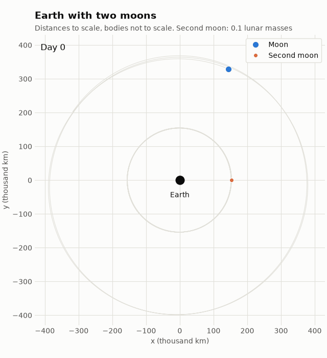
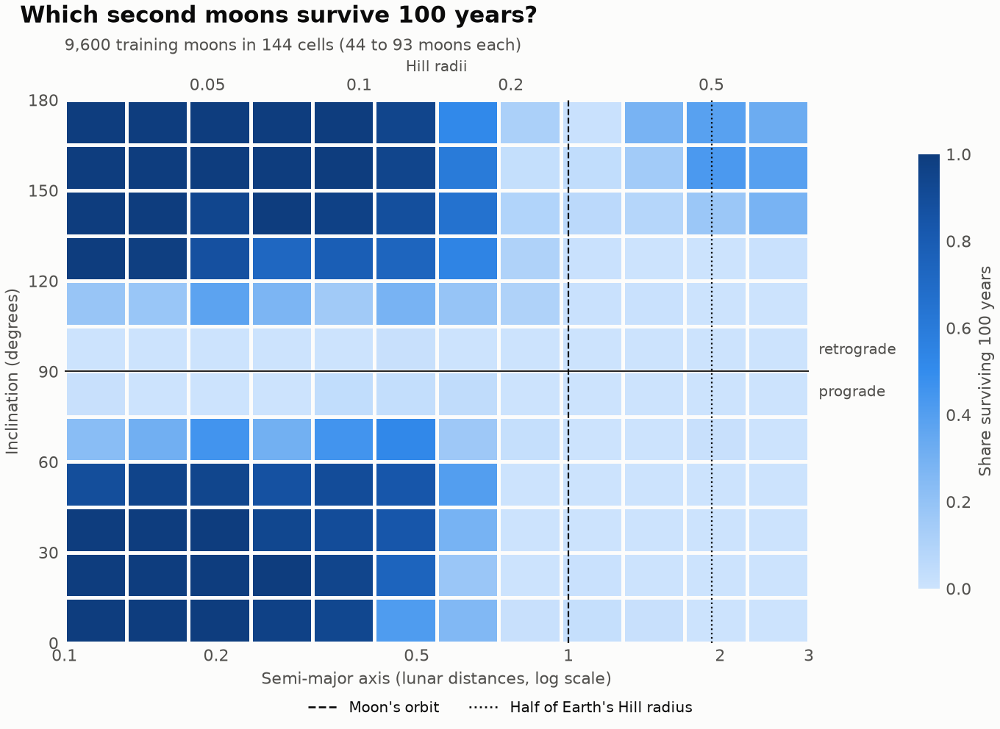

# What if Earth had 2 moons?

Simulating Earth, the Moon and a hypothetical second moon with N-body gravity
([REBOUND](https://rebound.readthedocs.io/)), then training a machine learning model to predict
the outcome from the starting conditions alone.

Inspired by SPOCK (Tamayo et al., 2020), which uses machine learning to predict the stability of
planetary systems.

**Status:** Phase 5 of 6 finished (surrogate model evaluated on the held-out test set). Next:
Phase 6, final cleanup and write-up.



## Results



- **Validated setup:** starting from NASA JPL Horizons data, the simulated Moon stays within
  10.3 km of its real position over a year (55,535 km if the Sun is left out).
- **12,000 random second moons**, from 0.001 to 1 lunar masses and 0.1 to 3 lunar distances,
  prograde and retrograde, each followed for up to 100 years: 38.0% survive, 32.0% are ejected,
  27.4% collide with Earth, 1.4% collide with the Moon, and in 1.2% the Moon itself is lost.
- **Chaos limits prediction:** moving a second moon by 1 meter changes 12% of outcomes.
- **Where second moons survive:** close, low-inclination orbits (96.5% survive). Near-polar
  orbits are driven into Earth (99.1%), consistent with Lidov–Kozai cycles; orbits reaching the
  Moon's are ejected or collide. Beyond the Moon's orbit, survivors are almost all retrograde (11.4% of
  retrograde vs 0.3% of prograde moons survive).
- **Beyond 100 years:** of 500 survivors followed to 1,000 years, 21.4% are lost.
- **Machine-learning surrogate:** a Random Forest predicts the outcome from the starting values.
  On 2,400 held-out systems, evaluated once under criteria fixed in advance, it reaches 85.1%
  accuracy (physics rule 78.9%, majority class 38.0%) with calibrated survival probabilities
  (ROC AUC 0.988). Its errors concentrate on chaotic systems near the Moon's orbit.
- **Speed:** 24 times faster than a median simulation per prediction, about 80,000 times faster
  in batches; it repays the cost of its training simulations after about 7,000 predictions.

## Try it

```powershell
venv\Scripts\python src\predict.py --mass 0.1 --distance 0.4 --eccentricity 0.0 --inclination 90
```

Mass in lunar masses, semi-major axis in lunar distances, inclination in degrees (above 90 is
retrograde). The tool prints the probabilities of each outcome and of each lifetime class; see the
[model card](docs/model_card.md) for valid ranges and limits.

## Documentation

| Document | Contents |
|---|---|
| [docs/report.md](docs/report.md) | Technical report: key findings, then methods, results and decisions phase by phase |
| [docs/questions.md](docs/questions.md) | Design decisions and open questions, with evidence |
| [docs/figures.md](docs/figures.md) | How to read every figure |
| [docs/model_card.md](docs/model_card.md) | The prediction model: use, performance, limits |
| [docs/glossary.md](docs/glossary.md) | Physics, statistics and machine learning terms |
| [notebooks/01_first_simulation.ipynb](notebooks/01_first_simulation.ipynb) | Setup, validation and a first second moon |
| [notebooks/02_dataset_exploration.ipynb](notebooks/02_dataset_exploration.ipynb) | Stability maps, decision rules and long-term survival |
| [notebooks/03_models.ipynb](notebooks/03_models.ipynb) | Surrogate models, chaos reference and the selected model |
| [notebooks/04_evaluation.ipynb](notebooks/04_evaluation.ipynb) | Held-out test evaluation, failures and speed |
| [paper/](paper/README.md) | Manuscript draft (AASTeX) |
| [notes.md](notes.md) | Lab notes and key numbers |

## Setup

Requires Python 3.14 (the version used for development).

Windows (PowerShell):

```powershell
python -m venv venv
venv\Scripts\python -m pip install -r requirements.txt
```

macOS / Linux:

```bash
python3 -m venv venv
venv/bin/python -m pip install -r requirements.txt
```

`requirements-lock.txt` lists every installed package version on the development computer (Windows).

## Reproducing the results

Run from the project folder. On macOS / Linux use `venv/bin/python` and `/` instead of
`venv\Scripts\python` and `\`. Long batch runs can be stopped and resumed by running the same
command again.

### Phase 1: setup and validation

| Command | What it does |
|---|---|
| `venv\Scripts\python src\horizons.py` | Downloads the NASA starting data if it is not saved yet |
| `venv\Scripts\python src\fetch_reference.py` | Downloads NASA's Moon positions for the validation |
| `venv\Scripts\python src\simulate.py` | Simulates the real Sun, Earth and Moon for one year |
| `venv\Scripts\python src\validate_real_system.py` | Compares the simulated Moon with NASA's |
| `venv\Scripts\python src\plot_real_system.py` | Draws the validation figures |
| `venv\Scripts\python src\simulate.py configs\single_run.json` | Simulates 10 years with a second moon |
| `venv\Scripts\python src\plot_single_run.py` | Draws the figures of that run |
| `venv\Scripts\python src\animate.py` | Saves the orbit GIF (a few minutes) |

### Phase 2: dataset generation

| Command | What it does |
|---|---|
| `venv\Scripts\python src\generate_dataset.py configs\pilot.json` | Pilot: 100 random second moons (also `pilot_strict`, `pilot_shift`, `pilot_2026-05-01`, `pilot_2026-09-01`) |
| `venv\Scripts\python src\analyze_pilot.py` | Applies the pilot decision rules and draws the pilot figures |
| `venv\Scripts\python src\generate_dataset.py configs\dataset.json` | Full dataset: 12,000 second moons (about 5 hours with 4 workers) |
| `venv\Scripts\python src\make_manifest.py configs\dataset.json` | Records the dataset's SHA-256, counts and package versions |

### Phase 3: exploration

| Command | What it does |
|---|---|
| `venv\Scripts\python src\split.py` | Sets aside the held-out test set (run once) |
| `venv\Scripts\python src\plot_dataset.py` | Applies rules R1–R3 and draws the stability maps |
| `venv\Scripts\python src\compare_pilot.py` | Investigates the pilot-versus-dataset survival gap |
| `venv\Scripts\python src\select_survivors.py` | Chooses 500 survivors to follow for 1,000 years (run once) |
| `venv\Scripts\python src\generate_dataset.py configs\survivors_1000yr.json` | Follows those survivors to 1,000 years (about 4.5 hours) |
| `venv\Scripts\python src\survival_curve.py` | Applies rule R4 and draws survival to 1,000 years |
| `venv\Scripts\python src\long_run.py` | Follows the first second moon for 1,000 years |
| `venv\Scripts\python src\paper_numbers.py` | Prints every derived number quoted in the paper |

### Phase 4: surrogate models

| Command | What it does |
|---|---|
| `venv\Scripts\python src\select_twins.py` | Chooses 1,500 training moons to re-simulate with a 1 m nudge (run once) |
| `venv\Scripts\python src\generate_dataset.py configs\twins_1m.json` | Simulates the chaos twins (about 40 minutes) |
| `venv\Scripts\python src\train_models.py baselines` | Majority-class and physics-rule baselines |
| `venv\Scripts\python src\train_models.py features` | Rule P1: chooses the input feature set |
| `venv\Scripts\python src\train_models.py compare` | Rules P2, P3, P6: nested comparison of four models (about 1 hour) |
| `venv\Scripts\python src\train_models.py final` | Final settings of the selected model for Phase 5 |
| `venv\Scripts\python src\train_models.py lifetime` | Secondary task: predicts the lifetime class |
| `venv\Scripts\python src\analyze_models.py` | Chaos reference, rules P4 and P5, learning curve, importance, Phase 5 criteria |
| `venv\Scripts\python src\plot_models.py` | Draws the Phase 4 figures |

### Phase 5: test-set evaluation

| Command | What it does |
|---|---|
| `venv\Scripts\python src\evaluate_test.py --dry-run` | Rehearses the evaluation on a training holdout (no test moons) |
| `venv\Scripts\python src\evaluate_test.py` | The single evaluation on the held-out test set (refuses to run twice) |
| `venv\Scripts\python src\benchmark_speed.py` | Times the model and the simulation on the same machine (about 15 minutes) |
| `venv\Scripts\python src\select_twins.py --test` | Chooses 600 test moons for the failure analysis (after the evaluation) |
| `venv\Scripts\python src\generate_dataset.py configs\twins_test_1m.json` | Simulates the test chaos twins (about 25 minutes) |
| `venv\Scripts\python src\analyze_test.py` | Rule T5, error map, coverage-accuracy curve, cross-validated versus test |
| `venv\Scripts\python src\plot_test.py` | Draws the Phase 5 figures |
| `venv\Scripts\python src\predict.py --mass ... --distance ... --eccentricity ... --inclination ...` | Predicts the fate of any second moon |

### Checks (each prints PASS or FAIL)

| Command | What it checks |
|---|---|
| `venv\Scripts\python src\check_setup.py` | The packages, by simulating one simple orbit |
| `venv\Scripts\python src\check_initial_state.py` | The saved NASA data (add `--online` to ask NASA again) |
| `venv\Scripts\python src\check_events.py` | Collision and ejection detection |
| `venv\Scripts\python src\check_second_moon.py` | The second moon's setup, collisions and ejection |
| `venv\Scripts\python src\check_summary.py` | The lightweight simulation mode and its settings |
| `venv\Scripts\python src\check_sampling.py` | The random second moons and outcome labels |
| `venv\Scripts\python src\check_generate.py` | The batch runner: workers, resuming, chosen ids |
| `venv\Scripts\python src\check_dataset.py configs\dataset.json` | The finished dataset, including 20 re-simulated moons |
| `venv\Scripts\python src\check_explore.py` | The test split and the exploration helpers |
| `venv\Scripts\python src\check_models.py` | Model inputs, targets and cross-validation: leaks, test-set guard, reproducibility |
| `venv\Scripts\python src\check_evaluation.py` | Phase 5 safeguards: test access, frozen criteria, determinism, dry run, prediction tool |
| `venv\Scripts\python src\check_release.py` | Release checklist: frozen results, links, imports, wording, consistent numbers |

## Code layout

Shared modules used by the scripts above:

| Module | Contents |
|---|---|
| `src/horizons.py` | JPL Horizons download and loading of the starting state |
| `src/simulate.py` | Building and running a simulation; collision and ejection detection |
| `src/second_moon.py` | Turning orbital elements into a second moon |
| `src/sampling.py` | Random second-moon parameters and the Roche-limit rule |
| `src/labels.py` | Outcome labels |
| `src/generate_dataset.py` | Parallel, resumable batch runner |
| `src/explore.py` | Loading the training data, binned shares, reweighting, bootstrap |
| `src/features.py` | Model inputs (feature sets F1–F3) and targets |
| `src/models.py` | Model pipelines and hyperparameter search spaces |
| `src/cv.py` | Nested cross-validation, metrics and paired bootstrap comparisons |
| `src/predict.py` | The evaluated model as a prediction tool (also importable) |
| `src/plot_style.py` | Shared figure style |

## Data and reproducibility

- Generated data in `data/` is not stored in Git; every file can be regenerated with the commands
  above. `configs/dataset_manifest.json`, `configs/survivors_1000yr_manifest.json` and
  `configs/twins_1m_manifest.json`, `configs/twins_test_1m_manifest.json` record the
  SHA-256 checksum, outcome counts, computing time and package versions of each dataset.
- Every random draw uses a fixed seed stored in its configuration file, and every second moon has
  its own generator, so results do not depend on the order in which simulations finish.
- 2,400 systems (20%, `configs/split.json`) are held out for the final model evaluation and are
  not used for exploration or model development.
- Model results in `data/phase4/` are regenerated with `src/train_models.py`; the selected model's
  settings and the pre-registered Phase 5 criteria are stored in `configs/selected_model.json`.

## Folders

| Folder | Contents |
|---|---|
| `configs/` | Starting conditions, simulation settings, manifests and the test split |
| `src/` | Simulation, analysis and figure code |
| `notebooks/` | Walkthroughs |
| `figures/` | Charts and animations |
| `docs/` | Technical report, design decisions, figure guide, glossary |
| `paper/` | Manuscript draft and bibliography |
| `results/` | Committed test-set results and predictions (Phase 5) |
| `data/` | Generated simulation results (not stored in Git) |

## Known limitations

- Newtonian gravity only: other planets, tides, Earth's equatorial bulge and relativity are not
  modeled, so results should not be read as predictions over millions of years.
- "Survived" means surviving 100 years, not permanent stability.
- Outcome shares depend on the chosen parameter ranges and sampling distributions.

## Acknowledgments

Starting conditions and reference positions come from the
[NASA JPL Horizons](https://ssd.jpl.nasa.gov/horizons/) system. Simulations use
[REBOUND](https://rebound.readthedocs.io/) with the IAS15 integrator.

## License and citation

Code is released under the [MIT License](LICENSE). To cite this project, use the metadata in
[CITATION.cff](CITATION.cff) (GitHub's "Cite this repository" button).

Author: John Rey Ishiguro Quizon, STI College Legazpi.
