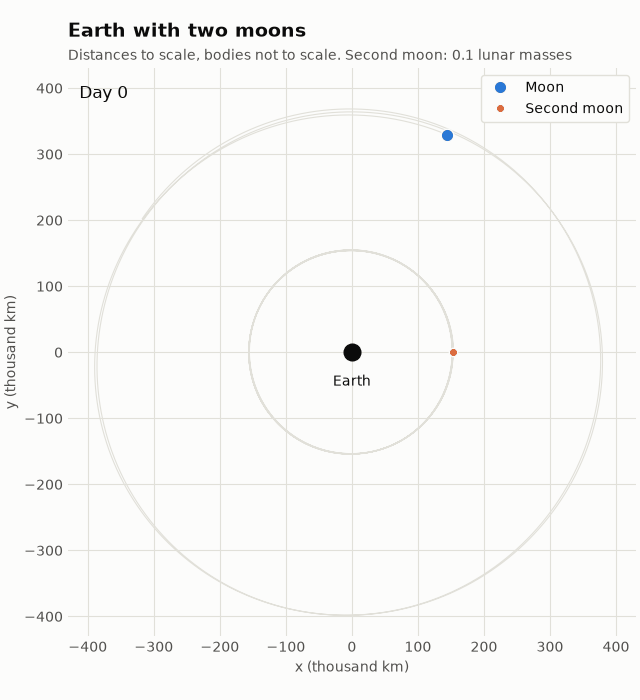
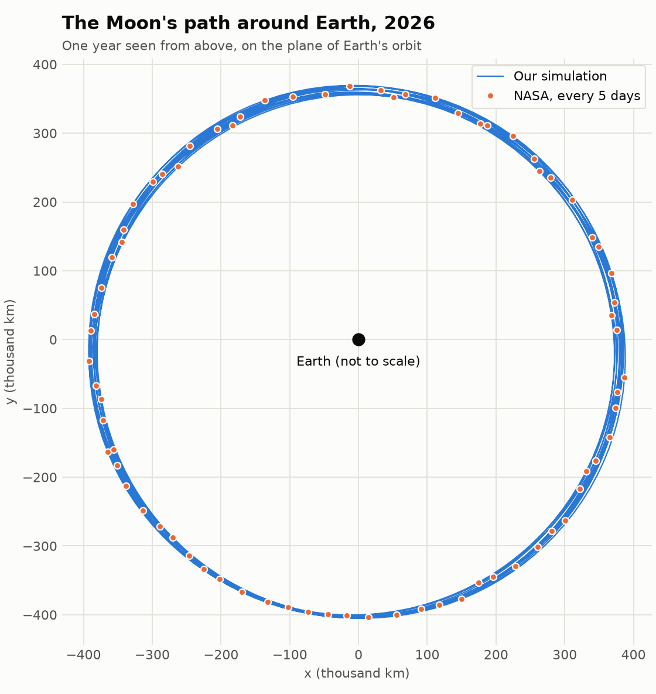
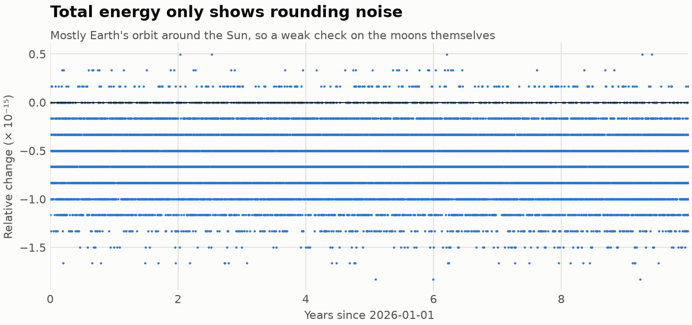
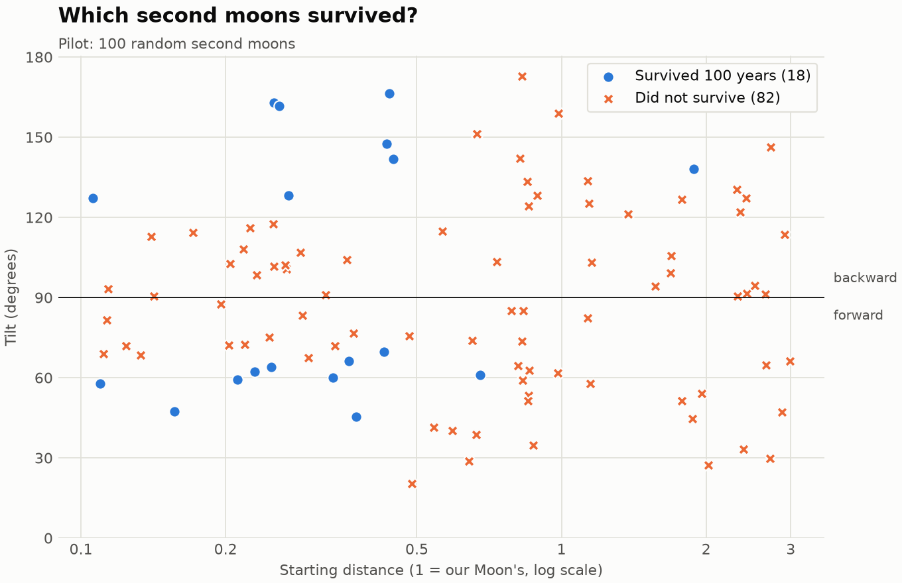

# Figure guide

Description, reading guide, interpretation and caveats for every figure in `figures/`. Each figure
is produced by a script and can be regenerated exactly. Terms are defined in the
[glossary](glossary.md).

Color convention: **blue** for the Moon, surviving systems or the reference simulation;
**orange** for the second moon, non-surviving systems or comparison runs.

| Figure | Phase | Script |
|---|---|---|
| [two_moons.gif](#two_moonsgif) | 1 | `src/animate.py` |
| [real_moon_orbit.png](#real_moon_orbitpng) | 1 | `src/plot_real_system.py` |
| [real_moon_error.png](#real_moon_errorpng) | 1 | `src/plot_real_system.py` |
| [two_moons_distance.png](#two_moons_distancepng) | 1 | `src/plot_single_run.py` |
| [two_moons_energy.png](#two_moons_energypng) | 1 | `src/plot_single_run.py` |
| [pilot_outcomes.png](#pilot_outcomespng) | 2 | `src/analyze_pilot.py` |
| [pilot_survival.png](#pilot_survivalpng) | 2 | `src/analyze_pilot.py` |

---

## two_moons.gif

**Content.** 60 days of the Earth-centered system viewed from above the ecliptic: the Moon and a
hypothetical second moon of 0.1 lunar masses on a circular orbit at 0.4 lunar distances. Frames
are 6 hours apart; trails show the previous 5 days.

**Reading.** The second moon completes about four orbits per lunar orbit, as expected from
Kepler's third law (0.4^1.5 ≈ 0.25).

**Interpretation.** An illustration of the system studied; quantitative results are in the
figures below.

**Caveats.** Distances are to scale; body sizes are not. The frame is centered on Earth, so
Earth's motion around the Sun is not shown.

---

## real_moon_orbit.png

**Content.** The Moon's path around Earth during 2026, projected onto the ecliptic. Line:
simulation. Points: JPL Horizons positions every 5 days.

**Reading.** Every JPL point lies on the simulated path. The orbit is an ellipse (about 357,000 to
405,000 km from Earth) whose orientation and shape are slowly changed by the Sun, so successive
orbits do not overlap exactly.

**Interpretation.** The simulation reproduces the Moon's orbit at the scale of the figure.

**Caveats.** Errors of order 10 km are invisible at this scale; they are quantified in the next
figure.

---

## real_moon_error.png

**Content.** Distance between the simulated and JPL Moon positions over one year, with the Sun
included (blue) and omitted (orange).

**Reading.** Logarithmic vertical axis: each gridline is a factor of 10. With the Sun, the error
grows slowly to about 10 km. Without it, the error exceeds 4,000 km within weeks and peaks at
55,535 km.

**Interpretation.**
- The simulation is accurate to 10.3 km after one year (about 0.003% of the Earth-Moon distance).
- Solar perturbations dominate the error budget; the Sun cannot be omitted.
- The slow growth of the blue curve is consistent with small unmodeled effects (other planets,
  tides, oblateness) accumulating over time.

**Caveats.** One year from one start date; errors continue to grow over longer integrations.

---

## two_moons_distance.png

**Content.** Earth distance of the Moon (blue) and the second moon (orange) over a 10-year
integration.

**Reading.** Each oscillation is one orbit; the height of each band reflects the orbit's
eccentricity, and a circular orbit would appear as a flat line.
- The Moon's band is steady at about 357,000 to 403,000 km.
- The second moon starts on a circular orbit (a thin line) and its band widens: the yearly
  distance range grows from 5,847 km in the first year to 14,726 km in the tenth.

**Interpretation.** Both moons survive, but the second moon's eccentricity is being excited by
lunar perturbations. Survival over a fixed interval does not imply an unchanging orbit, which is
why `survived` in the dataset means a lifetime of at least 100 years.

**Caveats.** A single system over 10 years; whether the growth continues or oscillates is open
(Q9 in [questions.md](questions.md)).

---

## two_moons_energy.png

**Content.** Relative change in the total energy of the system during the 10-year integration.

**Reading.** The vertical axis is in units of 10⁻¹⁵. Values fall on discrete levels set by
floating-point precision. No systematic drift is present.

**Interpretation.** The integration conserves energy to rounding precision.

**Caveats.** The total is dominated by Earth's heliocentric orbit, so errors confined to the moons
could be masked. The ephemeris comparison is the more sensitive test.

---

## pilot_outcomes.png

**Content.** The 100 pilot moons by initial semi-major axis (logarithmic horizontal axis) and
inclination. Circles: survived 100 years. Crosses: collided or were ejected. Above 90° the orbit
is retrograde.

**Reading.**
- 17 of the 18 survivors start within 0.7 lunar distances. Beyond 1 lunar distance, 24 of 30 moons
  are ejected.
- Prograde survivors have inclinations of about 45° to 70°; retrograde survivors about 125° to
  166°, flatter than most retrograde non-survivors (concentrated between 90° and 120°).
- Few points lie near 0° because the pilot sampled inclination isotropically.

**Interpretation.** Outcomes are structured in parameter space, the pattern a surrogate model
must learn. The sparse coverage of near-planar orbits motivated the change of inclination
sampling for the full dataset.

**Caveats.** 100 moons; mass, eccentricity and orientation angles also vary but are not shown.
Stability maps from the full dataset (Phase 3) supersede this figure.

---

## pilot_survival.png

**Content.** Fraction of the 100 pilot moons not yet collided or ejected, as a function of time.

**Reading.** Each step down is one collision or ejection. Logarithmic time axis. The surviving
fraction is 88% at 1 year, 45% at 10 years and 18% at 100 years, and is still declining at the end.

**Interpretation.** Losses continue on every timescale from months to a century, so the choice of
time limit materially affects the share labeled `survived`.

**Caveats.** All runs reached either a terminal event or the 100-year limit, so this is a simple
empirical fraction; with censoring before the limit, a Kaplan-Meier estimate would be needed.
Based on isotropic inclination sampling.
