# Figure guide

Description, reading guide, interpretation and caveats for every figure in `figures/`. Each figure
is produced by a script and can be regenerated exactly. Terms are defined in the
[glossary](glossary.md).

Color convention: **blue** for the Moon, surviving systems or the reference simulation;
**orange** for the second moon, non-surviving systems or comparison runs.

| Figure | Phase | Script |
|---|---|---|
| [two_moons.gif](#two_moonsgif) | 1 | `src/animate.py` |
| [real_moon_orbit.png](#real_moon_orbitpng) | 1 | `src/plot_real_system.py` |
| [real_moon_error.png](#real_moon_errorpng) | 1 | `src/plot_real_system.py` |
| [two_moons_distance.png](#two_moons_distancepng) | 1 | `src/plot_single_run.py` |
| [two_moons_energy.png](#two_moons_energypng) | 1 | `src/plot_single_run.py` |
| [pilot_outcomes.png](#pilot_outcomespng) | 2 | `src/analyze_pilot.py` |
| [pilot_survival.png](#pilot_survivalpng) | 2 | `src/analyze_pilot.py` |
| [stability_map.png](#stability_mappng) | 3 | `src/plot_dataset.py` |
| [outcome_maps.png](#outcome_mapspng) | 3 | `src/plot_dataset.py` |
| [stability_map_eccentricity.png](#stability_map_eccentricitypng) | 3 | `src/plot_dataset.py` |
| [survival_by_direction.png](#survival_by_directionpng) | 3 | `src/plot_dataset.py` |
| [survival_curve_full.png](#survival_curve_fullpng) | 3 | `src/survival_curve.py` |
| [first_moon_long_term.png](#first_moon_long_termpng) | 3 | `src/long_run.py` |
| [model_comparison.png](#model_comparisonpng) | 4 | `src/plot_models.py` |
| [confusion_matrix_cv.png](#confusion_matrix_cvpng) | 4 | `src/plot_models.py` |
| [calibration.png](#calibrationpng) | 4 | `src/plot_models.py` |
| [chaos_profile.png](#chaos_profilepng) | 4 | `src/plot_models.py` |
| [feature_importance.png](#feature_importancepng) | 4 | `src/plot_models.py` |
| [predicted_map.png](#predicted_mappng) | 4 | `src/plot_models.py` |
| [learning_curve.png](#learning_curvepng) | 4 | `src/plot_models.py` |
| [lifetime_confusion.png](#lifetime_confusionpng) | 4 | `src/plot_models.py` |
| [test_vs_cv.png](#test_vs_cvpng) | 5 | `src/plot_test.py` |
| [test_confusion.png](#test_confusionpng) | 5 | `src/plot_test.py` |
| [test_calibration.png](#test_calibrationpng) | 5 | `src/plot_test.py` |
| [error_map.png](#error_mappng) | 5 | `src/plot_test.py` |
| [coverage_accuracy.png](#coverage_accuracypng) | 5 | `src/plot_test.py` |
| [speedup.png](#speeduppng) | 5 | `src/plot_test.py` |

---

## two_moons.gif

**Content.** 60 days of the Earth-centered system viewed from above the ecliptic: the Moon and a
hypothetical second moon of 0.1 lunar masses on a circular orbit at 0.4 lunar distances. Frames
are 6 hours apart; trails show the previous 5 days.

**Reading.** The second moon completes about four orbits per lunar orbit, as expected from
Kepler's third law (0.4^1.5 ≈ 0.25).

**Interpretation.** An illustration of the system studied; quantitative results are in the
figures below.

**Caveats.** Distances are to scale; body sizes are not. The frame is centered on Earth, so
Earth's motion around the Sun is not shown.

---

## real_moon_orbit.png

**Content.** The Moon's path around Earth during 2026, projected onto the ecliptic. Line:
simulation. Points: JPL Horizons positions every 5 days.

**Reading.** Every JPL point lies on the simulated path. The orbit is an ellipse (about 357,000 to
405,000 km from Earth) whose orientation and shape are slowly changed by the Sun, so successive
orbits do not overlap exactly.

**Interpretation.** The simulation reproduces the Moon's orbit at the scale of the figure.

**Caveats.** Errors of order 10 km are invisible at this scale; they are quantified in the next
figure.

---

## real_moon_error.png

**Content.** Distance between the simulated and JPL Moon positions over one year, with the Sun
included (blue) and omitted (orange).

**Reading.** Logarithmic vertical axis: each gridline is a factor of 10. With the Sun, the error
grows slowly to about 10 km. Without it, the error exceeds 4,000 km within weeks and peaks at
55,535 km.

**Interpretation.**
- The simulation is accurate to 10.3 km after one year (about 0.003% of the Earth-Moon distance).
- Solar perturbations dominate the error budget; the Sun cannot be omitted.
- The slow growth of the blue curve is consistent with small unmodeled effects (other planets,
  tides, oblateness) accumulating over time.

**Caveats.** One year from one start date; errors continue to grow over longer integrations.

---

## two_moons_distance.png

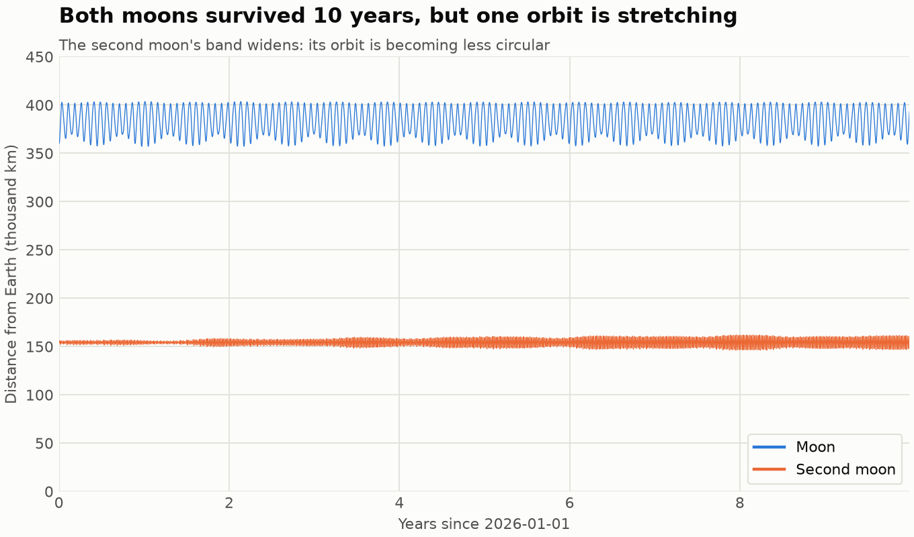

**Content.** Earth distance of the Moon (blue) and the second moon (orange) over a 10-year
integration.

**Reading.** Each oscillation is one orbit; the height of each band reflects the orbit's
eccentricity, and a circular orbit would appear as a flat line.
- The Moon's band is steady at about 357,000 to 403,000 km.
- The second moon starts on a circular orbit (a thin line) and its band widens: the yearly
  distance range grows from 5,847 km in the first year to 14,726 km in the tenth.

**Interpretation.** Both moons survive, but the second moon's eccentricity is being excited by
lunar perturbations. Survival over a fixed interval does not imply an unchanging orbit, which is
why `survived` in the dataset means a lifetime of at least 100 years.

**Caveats.** A single system over 10 years; whether the growth continues or oscillates is open
(Q9 in [questions.md](questions.md)).

---

## two_moons_energy.png

**Content.** Relative change in the total energy of the system during the 10-year integration.

**Reading.** The vertical axis is in units of 10⁻¹⁵. Values fall on discrete levels set by
floating-point precision. No systematic drift is present.

**Interpretation.** The integration conserves energy to rounding precision.

**Caveats.** The total is dominated by Earth's heliocentric orbit, so errors confined to the moons
could be masked. The ephemeris comparison is the more sensitive test.

---

## pilot_outcomes.png

**Content.** The 100 pilot moons by initial semi-major axis (logarithmic horizontal axis) and
inclination. Circles: survived 100 years. Crosses: collided or were ejected. Above 90° the orbit
is retrograde.

**Reading.**
- 17 of the 18 survivors start within 0.7 lunar distances. Beyond 1 lunar distance, 24 of 30 moons
  are ejected.
- Prograde survivors have inclinations of about 45° to 70°; retrograde survivors about 125° to
  166°, flatter than most retrograde non-survivors (concentrated between 90° and 120°).
- Few points lie near 0° because the pilot sampled inclination isotropically.

**Interpretation.** Outcomes are structured in parameter space, the pattern a surrogate model
must learn. The sparse coverage of near-planar orbits motivated the change of inclination
sampling for the full dataset.

**Caveats.** 100 moons; mass, eccentricity and orientation angles also vary but are not shown.
Stability maps from the full dataset (Phase 3) supersede this figure.

---

## pilot_survival.png

**Content.** Fraction of the 100 pilot moons not yet collided or ejected, as a function of time.

**Reading.** Each step down is one collision or ejection. Logarithmic time axis. The surviving
fraction is 88% at 1 year, 45% at 10 years and 18% at 100 years, and is still declining at the end.

**Interpretation.** Losses continue on every timescale from months to a century, so the choice of
time limit materially affects the share labeled `survived`.

**Caveats.** All runs reached either a terminal event or the 100-year limit, so this is a simple
empirical fraction; with censoring before the limit, a Kaplan-Meier estimate would be needed.
Based on isotropic inclination sampling.

---

## stability_map.png

**Content.** Share of the 9,600 training moons surviving 100 years, binned by initial semi-major
axis (12 logarithmic bins, bottom axis in lunar distances, top axis in Hill radii) and inclination
(12 bins of 15°). Darker cells mean higher survival. Dashed line: the Moon's orbit. Dotted line:
half of Earth's Hill radius. Every cell holds 44 to 93 moons.

**Reading.**
- Inside about 0.5 lunar distances, low-inclination orbits (below 45° or above 135°) survive almost
  always (96.5%).
- A pale band around 90° runs across all distances: near-polar orbits rarely survive, even close to
  Earth.
- Beyond about 0.75 lunar distances the map is pale for prograde orbits (0.3% survive beyond
  the Moon's orbit); near-planar retrograde orbits (above 135°) keep substantial survival there.

**Interpretation.** Survival is structured by three mechanisms: close encounters with the Moon
(orbits reaching its distance), Lidov–Kozai cycles for strongly inclined orbits, and the greater
stability of retrograde orbits far from Earth. This is the structure a surrogate model must learn.

**Caveats.** Mass, eccentricity and orientation angles vary within each cell and are averaged over.
The inclination distribution is uniform in degrees, so cell shares are conditional on inclination
and not affected by that choice, but overall shares are (see Q24). Split-half correlation 0.991.

---

## outcome_maps.png

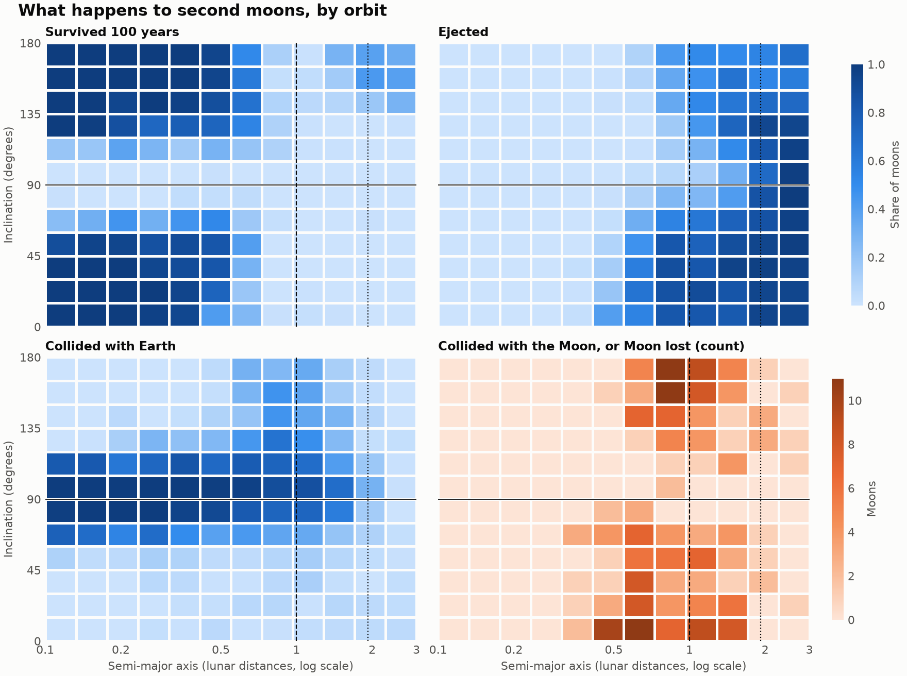

**Content.** Four panels on the axes of the stability map: shares of moons that survived, were
ejected, or collided with Earth (shared blue scale), and the number of rare outcomes (collision
with the Moon or loss of the Moon, orange scale).

**Reading.**
- Ejections dominate beyond the Moon's orbit, especially for prograde orbits.
- Collisions with Earth fill the near-polar band at all distances and the region around the Moon's
  orbit.
- Rare outcomes cluster between about 0.5 and 1.5 lunar distances, where the two moons interact
  most strongly; up to about 11 per cell.

**Interpretation.** Each outcome occupies its own region. The rare classes are concentrated near
the Moon's orbit, which matters for the Phase 4 choice between merging them and sampling that
region more densely.

**Caveats.** The rare-outcome panel shows counts, not shares, and is based on 254 training moons.

---

## stability_map_eccentricity.png

**Content.** Survival share by semi-major axis and eccentricity. Dashed curves mark orbits that
just touch the Moon's orbit: apoapsis equal to one lunar distance (left) and periapsis equal to one
lunar distance (right). Orbits between and above the two curves cross the Moon's orbit. Dotted
curve: periapsis at the Roche limit; orbits above it were excluded from sampling, which leaves the
upper-left cells empty.

**Reading.** Survival drops sharply where the left dashed curve is crossed: once the apoapsis
reaches the Moon's orbit, survival falls from about 60–80% to near zero. Orbits that cross the
Moon's orbit survive in 3.0% of cases. Outside the Moon's orbit, survival stays low at all
eccentricities.

**Interpretation.** Close approaches to the Moon are the main destabilizing mechanism for moons
near its distance. A simple geometric quantity, whether the orbit reaches the Moon's, captures
much of the outcome.

**Caveats.** Inclination is averaged over, including the near-polar orbits that fail for a
different reason. Split-half correlation 0.977.

---

## survival_by_direction.png

**Content.** Share surviving 100 years in each semi-major-axis bin (in Hill radii), separately for
prograde (blue) and retrograde (orange) training moons, with 95% Wilson intervals. Vertical lines:
the 10% survival edge from rule R2 (the same bin for both directions), the Moon's orbit, and the
prograde stability limit reported for a Jupiter-mass planet (0.49 Hill radii; Domingos et al. 2006).

**Reading.**
- Up to about 0.1 Hill radii both directions survive at 65–72%.
- Both fall below 10% just inside the Moon's orbit (about 0.22 Hill radii); retrograde survival
  falls more slowly.
- Beyond the Moon's orbit, prograde survival stays near 0% while retrograde survival recovers to
  about 17% between 0.5 and 0.78 Hill radii.

**Interpretation.** The Moon sets the outer limit for prograde second moons, well inside the limit
expected from the Sun alone. Retrograde orbits survive beyond the Moon, consistent with the greater
stability of retrograde satellites. Rule R2, as defined, does not detect this because both
directions cross 10% in the same bin.

**Caveats.** The literature limit applies to a planet with no other moon and is shown for
orientation only.

---

## survival_curve_full.png

**Content.** Fraction of systems not yet collided or ejected, from 0.1 to 1,000 years
(logarithmic time axis). Solid blue: the 9,600 training systems up to 100 years. Dashed blue with
band: beyond 100 years, the 100-year survival multiplied by the surviving share of 500 random
survivors integrated to 1,000 years, with a 95% interval. Dotted orange: the same curve reweighted
to isotropic inclinations. Grey: the 100-system pilot.

**Reading.** The training curve falls from 58% at 10 years to 38% at 100 years and 30% at 1,000
years. The slope flattens after 100 years but does not reach zero. The reweighted curve lies below
the training curve after a few years because near-planar orbits, which survive more often, carry
less weight under isotropic sampling. The pilot curve stays close to the reweighted curve for the
first few years and falls below it after about 3 years.

**Interpretation.** Losses continue on every timescale up to 1,000 years, more slowly after
100 years (21.4% of 100-year survivors lost by 1,000 years, against 34.7% of 10-year survivors
lost by 100 years). The 100-year label is a lower bound on lifetime.

**Caveats.** Beyond 100 years the curve rests on 500 systems; its band reflects that sample only.
The pilot curve is based on 100 systems (see rule R1 in the [technical report](report.md)).

---

## first_moon_long_term.png

**Content.** Eccentricity around Earth of the Phase 1 second moon (0.1 lunar masses, 0.4 lunar
distances, initially circular and planar) over 1,000 years, every 10 days (thin line) and as a
10-year running mean, with the Moon's 10-year mean for reference. The dotted line marks the end of
the original 10-year run.

**Reading.** The 10-year mean oscillates between 0.013 and 0.039 with no trend; the average is
0.0242 in both halves of the run. The dominant period is about 17 years. The Moon's mean
eccentricity stays near 0.052.

**Interpretation.** The growth in the distance range seen in Phase 1 (`two_moons_distance.png`)
was the rising part of a bounded oscillation, not the start of a runaway. This system appears
stable over at least 1,000 years.

**Caveats.** A single system. Osculating elements include short-period variations, which the
running mean smooths out.

---

## model_comparison.png

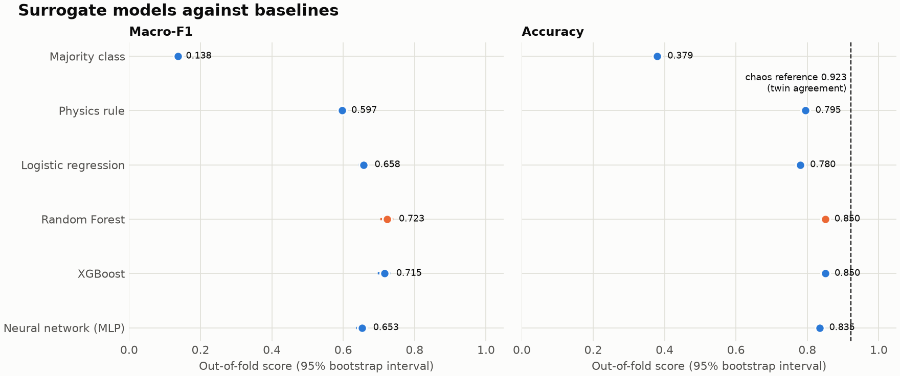

**Content.** Out-of-fold macro-F1 (left) and accuracy (right) of the two baselines and the four
candidate models on the 9,600 training systems, with 95% bootstrap intervals (mostly smaller than
the markers). The selected model is orange. The dashed line in the accuracy panel is the chaos
reference: the share of twin pairs whose outcome is unchanged by a 1 m displacement.

**Reading.** The Random Forest has the highest macro-F1 (0.723) and shares the highest accuracy
with XGBoost (0.850). The physics rule (0.597 macro-F1, 0.795 accuracy) already beats logistic
regression in accuracy; the neural network trails the tree ensembles. All models remain below the
chaos reference of 0.923.

**Interpretation.** Tree ensembles capture the sharp, non-linear outcome boundaries best. The gap
between the best model and the chaos reference is small compared with the gap to the baselines.

**Caveats.** Cross-validated on training data, with the feature set chosen on the same data, so
possibly optimistic; the held-out test set confirms the scores ([test_vs_cv.png](#test_vs_cvpng)). Macro-F1 has no direct chaos reference, so the reference is shown only for
accuracy.

---

## confusion_matrix_cv.png

**Content.** Out-of-fold predictions of the selected Random Forest: rows are simulated outcomes,
columns predicted outcomes; each cell gives the row share and the count.

**Reading.** Survivors are recognized in 92% of cases, ejections in 87% and collisions with Earth
in 79%. The largest confusions are collisions with Earth predicted as ejections (12%) and Moon
interactions predicted as ejections (46%). Only 30% of Moon interactions are recognized.

**Interpretation.** The three common outcomes are well separated. Moon interactions occur in the
same region as ejections (around the Moon's orbit) and are often decided by chaos, so they are
hard to distinguish from the starting conditions.

**Caveats.** Shares in the bottom row rest on 254 systems.

---

## calibration.png

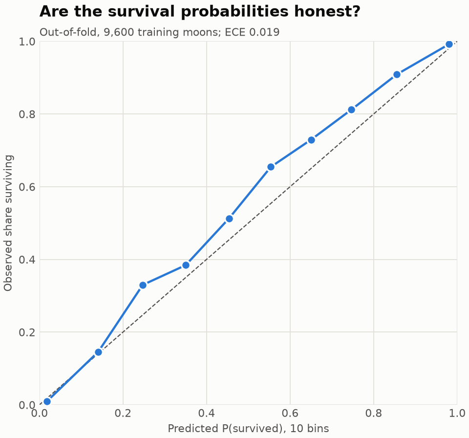

**Content.** Predicted survival probability (10 bins of width 0.1, bins with at least 20 systems)
against the observed share of survivors in each bin; the dashed diagonal marks perfect
calibration.

**Reading.** The points follow the diagonal closely; in the middle range observed survival is a
few points above the prediction. The expected calibration error is 0.019.

**Interpretation.** The probabilities can be read at face value: a system given 70% survives about
70% of the time, slightly more. No calibration step is needed (rule P6).

**Caveats.** Out-of-fold, training systems only. On the held-out test set the ECE is also 0.019
([test_calibration.png](#test_calibrationpng)).

---

## chaos_profile.png

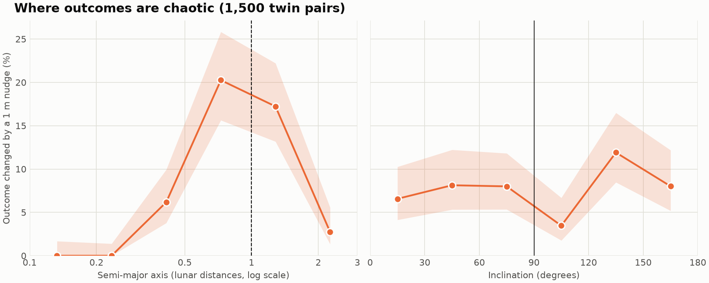

**Content.** Share of the 1,500 twin pairs whose outcome changed when the second moon was
displaced by 1 m, by semi-major axis (left, six logarithmic bins) and inclination (right, six
bins of 30°), with 95% Wilson intervals.

**Reading.** No pair changed inside 0.31 lunar distances. The share rises to 20.3% between 0.55
and 0.97 lunar distances and 17.2% between 0.97 and 1.70, then falls to 2.7% beyond. By
inclination, chaos ranges from 3.5% (90°–120°) to 11.9% (120°–150°).

**Interpretation.** Chaos is concentrated around the Moon's orbit, where close encounters amplify
small differences. Close-in systems, and near-polar systems that collide with Earth reliably, are
predictable.

**Caveats.** About 225–275 pairs per bin; the inclination profile is noisier than the distance
profile.

---

## feature_importance.png

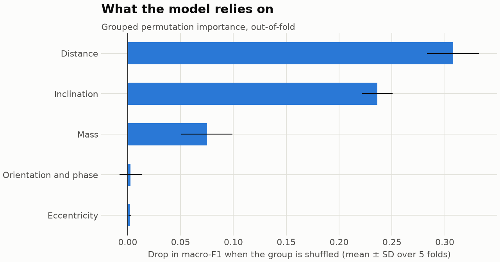

**Content.** Drop in out-of-fold macro-F1 when a group of related inputs is shuffled together,
averaged over 5 folds (error bars: standard deviation). Groups: distance (log semi-major axis,
periapsis, apoapsis, crossing flag), inclination (cos *i*, |cos *i*|, the Lidov–Kozai quantity),
mass, orientation and phase (angles, starting angle to the Moon), eccentricity.

**Reading.** Shuffling the distance group lowers macro-F1 by 0.31 and the inclination group by
0.24; mass follows with 0.075. Orientation, phase and eccentricity alone contribute almost nothing.

**Interpretation.** The model relies on the same two drivers as the physics: distance relative to
the Moon's orbit and inclination relative to 90°. Mass matters through its effect on the Moon.

**Caveats.** Eccentricity appears unimportant because periapsis and apoapsis, which contain it,
belong to the distance group. Importance describes this model, not causation.

---

## predicted_map.png

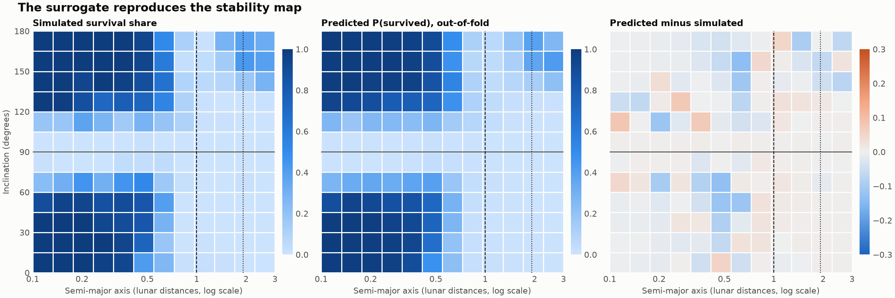

**Content.** Three panels on the stability-map grid: simulated survival share, mean out-of-fold
predicted P(survived), and their difference (orange: predicted higher; blue: lower).

**Reading.** The predicted map reproduces the simulated one: the survival regions inside
0.5 lunar distances, the near-polar band and the retrograde region beyond the Moon. The
differences are small (largest 0.13) and lie along the edges of the survival regions.

**Interpretation.** The surrogate has learned the structure of the stability map from the starting
conditions alone; its largest deviations are on region boundaries, where chaos is also strongest.

**Caveats.** Cell averages hide individual errors; see the confusion matrix.

---

## learning_curve.png

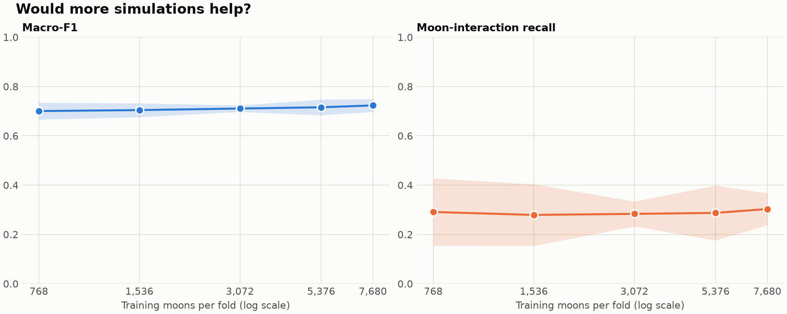

**Content.** Out-of-fold macro-F1 (left) and `moon_interaction` recall (right) of the selected
model trained on 10%, 20%, 40%, 70% and 100% of each training fold (768 to 7,680 systems), mean
± standard deviation over 5 folds.

**Reading.** Macro-F1 rises only from 0.700 to 0.723 over a tenfold increase in data; the
`moon_interaction` recall stays between 28% and 30%.

**Interpretation.** More simulations would improve the model little. Performance is limited by the
chaotic component of the outcomes rather than by the amount of data.

**Caveats.** The fold-to-fold spread of the recall is large.

---

## lifetime_confusion.png

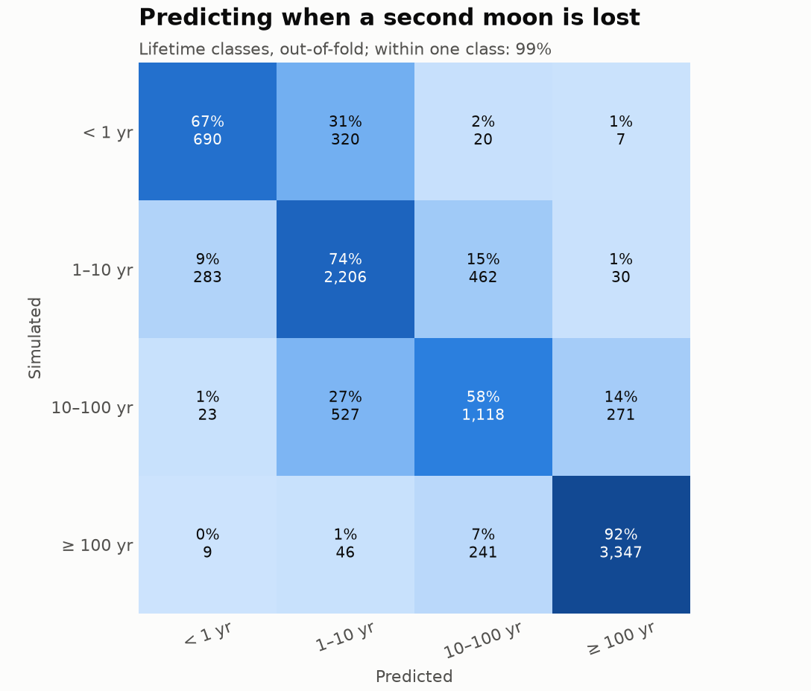

**Content.** Out-of-fold confusion matrix of the secondary task, the lifetime class: lost within
1 year, within 1–10 years, within 10–100 years, or surviving 100 years.

**Reading.** 92% of survivors, 74% of the 1–10 year class, 67% of the under-1-year class and 58% of
the 10–100 year class are classified correctly; nearly all errors fall in a neighbouring class
(98.6% of predictions are correct or one class off).

**Interpretation.** The starting conditions predict roughly when a system fails, not only whether
it does. Neighbouring classes overlap because lifetimes are continuous and partly chaotic.

**Caveats.** The class boundaries (1, 10 and 100 years) are fixed choices; survivors' true
lifetimes beyond 100 years are unknown.

---

## test_vs_cv.png

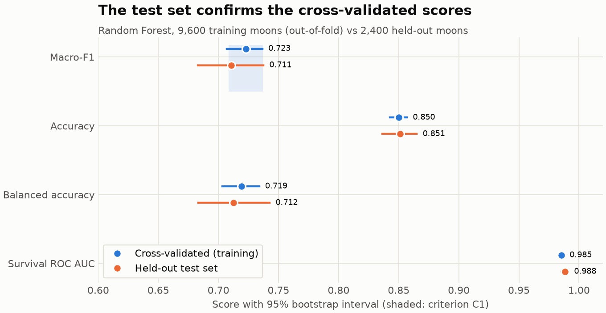

**Content.** Macro-F1, accuracy, balanced accuracy and survival ROC AUC of the selected Random
Forest, out-of-fold on the 9,600 training systems (blue) and on the 2,400 held-out test systems
(orange), with 95% bootstrap intervals. The shaded band in the macro-F1 row is criterion C1.

**Reading.** Each test value lies close to its cross-validated value: macro-F1 0.711 versus 0.723,
accuracy 0.851 versus 0.850, balanced accuracy 0.712 versus 0.719, survival AUC 0.988 versus 0.985.
The test intervals are about twice as wide, reflecting the smaller sample. The test macro-F1 falls
just inside the C1 band.

**Interpretation.** The model generalizes to systems never used for any decision, and the selection
optimism expected from choosing features on the training data is small.

**Caveats.** One test set of 2,400 systems; its sampling noise is about ±0.03 in macro-F1.

---

## test_confusion.png

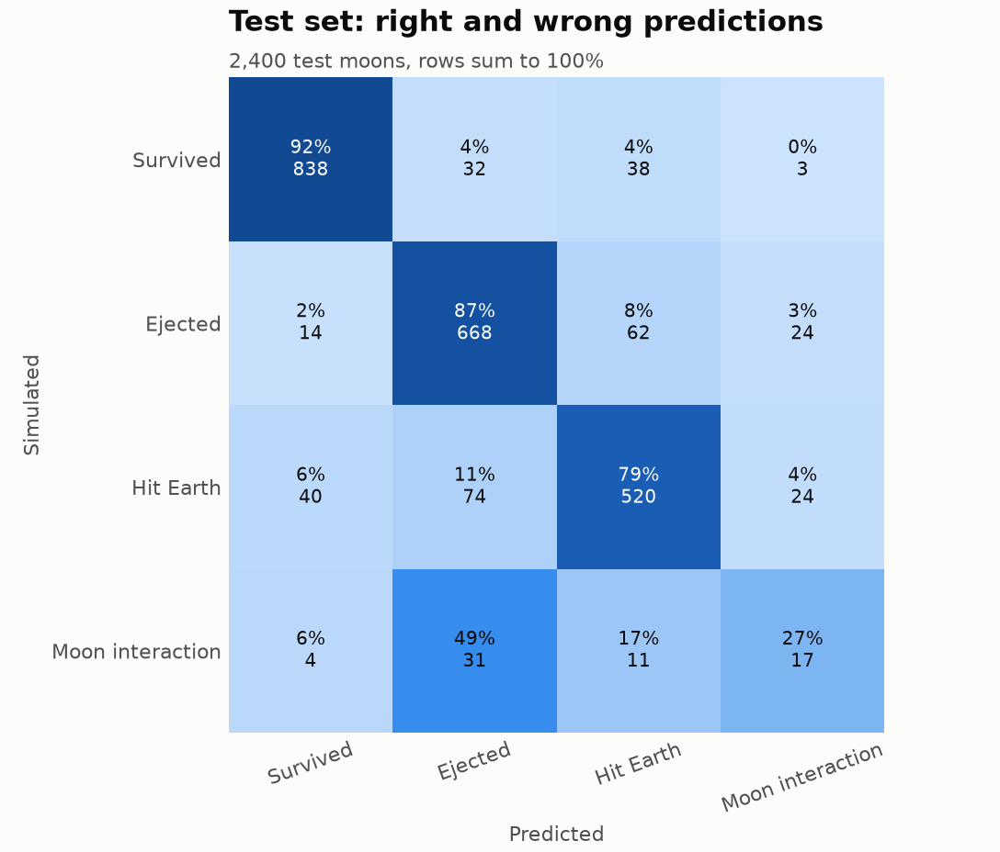

**Content.** Confusion matrix of the selected model on the 2,400 test systems: rows are simulated
outcomes, columns predicted outcomes, with row shares and counts.

**Reading.** Survivors are recognized in 92% of cases, ejections in 87%, collisions with Earth in
79% and Moon interactions in 27% (17 of 63). Collisions with Earth predicted as ejections (11%) and
Moon interactions predicted as ejections (49%) are the largest confusions.

**Interpretation.** The pattern matches the cross-validated confusion matrix almost cell by cell.

**Caveats.** The bottom row rests on 63 systems.

---

## test_calibration.png

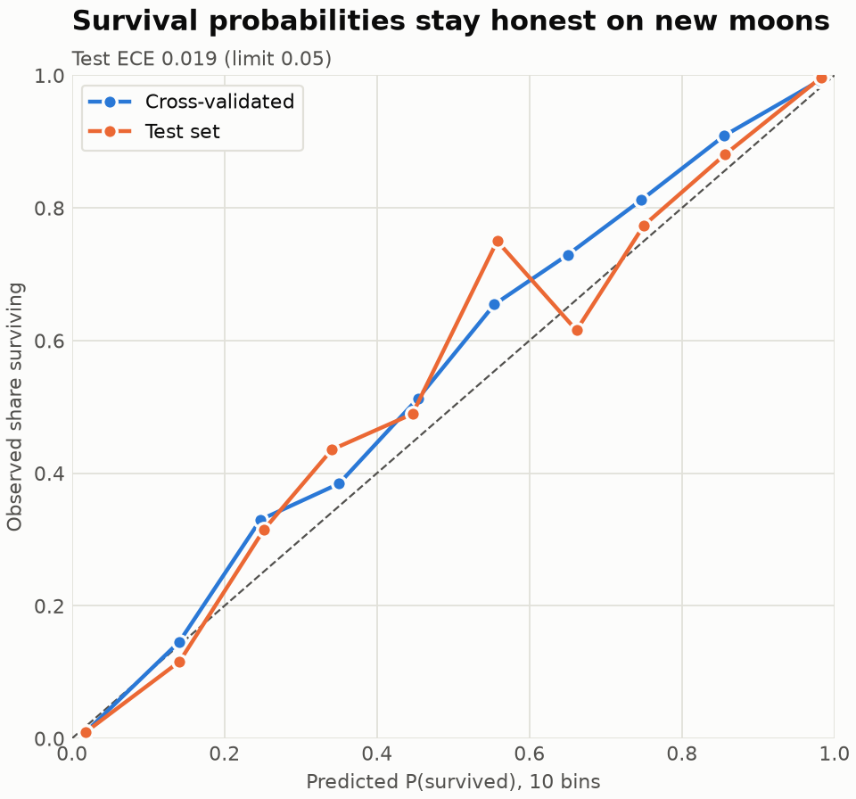

**Content.** Predicted survival probability (10 bins; bins with at least 10 test systems) against
the observed share of survivors, on the test set (orange) and out-of-fold on the training set
(blue).

**Reading.** The test curve follows the diagonal and the cross-validated curve, with more scatter in
the middle bins, which hold few systems. The test ECE is 0.019.

**Interpretation.** The survival probabilities remain honest on new systems (criterion C3). Every
class's one-vs-rest calibration error on the test set is at most 0.030.

**Caveats.** Middle bins contain few test systems; their scatter is mostly sampling noise.

---

## error_map.png

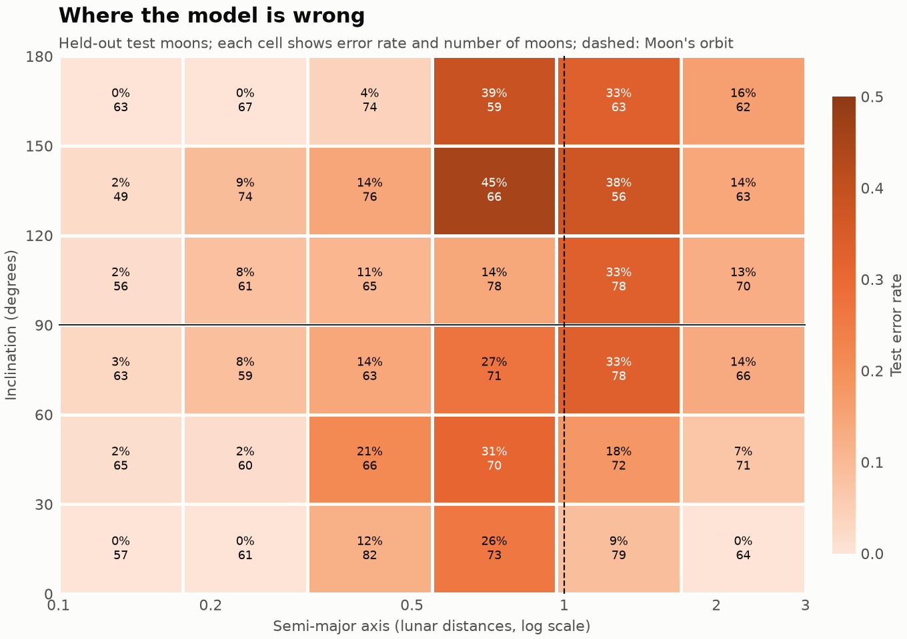

**Content.** Error rate of the selected model on the test set in a 6 × 6 grid of semi-major axis
(logarithmic) and inclination; each cell shows the error rate and the number of systems (49 to 82).
Dashed line: the Moon's orbit.

**Reading.** Systems inside 0.31 lunar distances are almost never misclassified (0–9%). The error
rate rises to 26–45% between 0.55 and 1.7 lunar distances, highest at 0.55–0.97 lunar distances and
120°–150° (45%), and falls again beyond 1.7 lunar distances.

**Interpretation.** Failures coincide with the chaotic region around the Moon's orbit
(`chaos_profile.png`); rule T5 confirms that test errors concentrate on systems whose outcome a
1 m nudge changes.

**Caveats.** Each cell's error rate has a Wilson interval of roughly ±10 points.

---

## coverage_accuracy.png

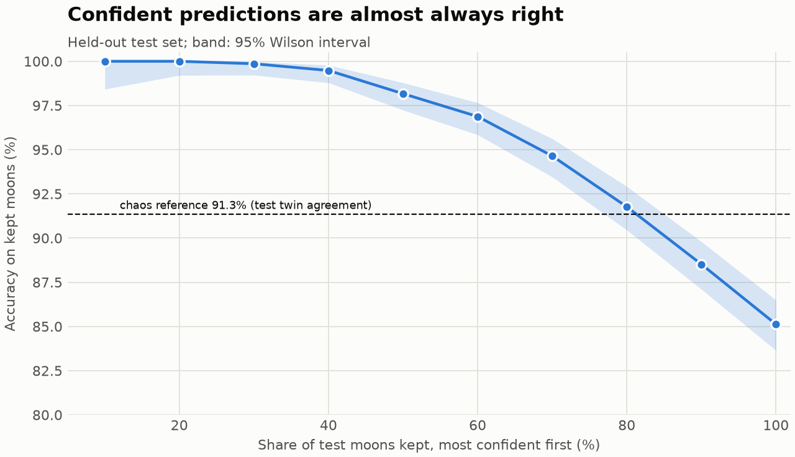

**Content.** Accuracy on the test systems kept when predictions are ranked by confidence (the
largest predicted probability) and only the most confident share is kept, with 95% Wilson
intervals. Dashed line: test twin agreement (91.3%).

**Reading.** The most confident 10–30% of predictions are essentially always right; keeping 50%
gives 98.2%, 80% gives 91.8% and all systems 85.1%.

**Interpretation.** The predicted probability is a reliable signal of when to trust the surrogate.
A workflow that simulates only the least confident systems would combine high accuracy with a large
saving in computation.

**Caveats.** Test set only; the curve's shape depends on the class mix of the sampled parameters.

---

## speedup.png

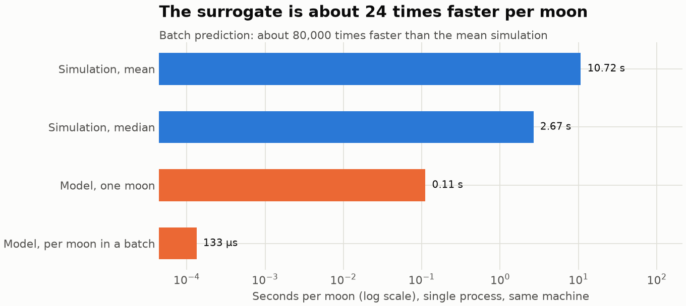

**Content.** Seconds per system on a logarithmic axis, measured single-threaded in one process on
the same machine: simulation mean and median (100 re-simulated training systems), and the model for
one prediction and per system in a batch of 2,400.

**Reading.** A simulation takes 2.67 s (median) or 10.72 s (mean); the model takes 0.11 s for one
prediction and 133 µs per system in a batch.

**Interpretation.** The surrogate is about 24 times faster than the median simulation for single
predictions and about 80,000 times faster than the mean simulation in batches. Counting the 20.8
CPU-hours of training simulations, it pays off after about 7,000 predictions.

**Caveats.** Absolute times depend on the hardware. Simulation time depends strongly on the outcome
(survivors about 20 s, failures under 1.1 s). Single-prediction latency is dominated by per-call
overhead.

---

## Paper figures (`paper/figures/`)

Drawn by `src/plot_paper.py` at print size (3.4 inches for one column, 6.0 inches for the
full-width map) as vector PDFs with embedded fonts, without titles, since the captions in
`paper/main.tex` carry them. They show the same data as the screen figures above:

| Paper figure | Screen counterpart | Difference |
|---|---|---|
| `paper_validation.pdf` | [real_moon_error](#real_moon_errorpng) | Largest errors in the legend |
| `paper_stability_map.pdf` | [stability_map](#stability_mappng) | Same map |
| `paper_survival.pdf` | [survival_curve_full](#survival_curve_fullpng) | Replaces the pilot-only survival figure in the paper |
| `paper_test_vs_cv.pdf` | [test_vs_cv](#test_vs_cvpng) | Legend below the axes |
| `paper_speed.pdf` | [speedup](#speeduppng) | No speedup title; the ratios are in the text |
| `rnaas_figure.pdf` | [stability_map](#stability_mappng) and [test_vs_cv](#test_vs_cvpng) | The single two-panel figure of the Research Notes version |
