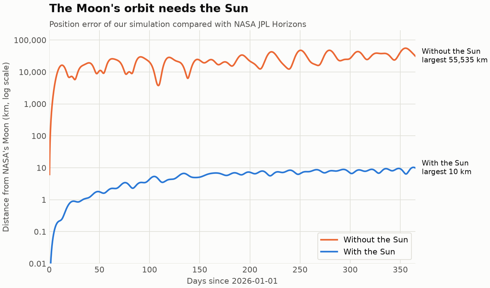
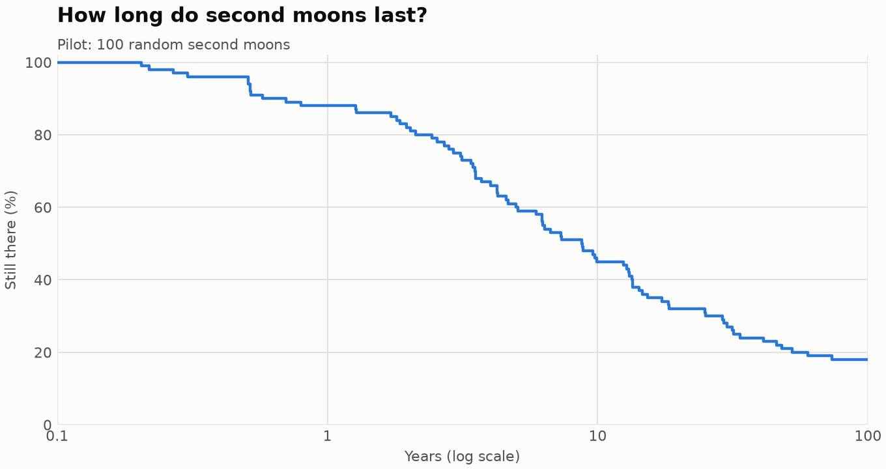

# Figures explained

Each figure: what it shows, how to read it, what it tells us, and its limits. Every figure is
made by a script, so it can be remade exactly. Updated whenever a figure is added or changed.

Colors are the same throughout: **blue** for our Moon, survivors or our simulation; **orange** for
the second moon, failures or comparisons.

| Figure | Phase | Made by | Good for the post? |
|---|---|---|---|
| [two_moons.gif](#two_moonsgif) | 1 | `src/animate.py` | Yes, the opening visual |
| [real_moon_orbit.png](#real_moon_orbitpng) | 1 | `src/plot_real_system.py` | Maybe |
| [real_moon_error.png](#real_moon_errorpng) | 1 | `src/plot_real_system.py` | Yes, shows the simulation is trustworthy |
| [two_moons_distance.png](#two_moons_distancepng) | 1 | `src/plot_single_run.py` | Yes, "survived is not stable" |
| [two_moons_energy.png](#two_moons_energypng) | 1 | `src/plot_single_run.py` | No, technical check |
| [pilot_outcomes.png](#pilot_outcomespng) | 2 | `src/analyze_pilot.py` | Maybe; Phase 3 maps will replace it |
| [pilot_survival.png](#pilot_survivalpng) | 2 | `src/analyze_pilot.py` | Yes, simple and striking |

---

## two_moons.gif

**What it shows:** 60 days of Earth (center), our Moon and the hypothetical second moon (0.1 lunar
masses, at 0.4 of the Moon's distance), seen from above. Each frame is 6 hours later; the trails
show the last 5 days.

**How to read it:** the second moon goes around about 4 times for each lap of our Moon. A closer
orbit is faster (Kepler's third law: period grows with distance to the power 1.5, and
0.4^1.5 ≈ 0.25).

**What it tells us:** what the question looks like. It doesn't prove anything; the charts below do.

**Limits:** distances are to scale, but Earth's and the moons' sizes are not. Earth looks still
because the view moves with it; in reality Earth is also going around the Sun.

---

## real_moon_orbit.png

**What it shows:** one year of the Moon's path around Earth in 2026, seen from above. Blue line:
our simulation. Orange dots: NASA's positions every 5 days.

**How to read it:** every orange dot sits on the blue line, so simulation and reality agree at
this scale. The orbit is not a perfect circle: it is an ellipse (about 357,000 to 405,000 km from
Earth), and the Sun slowly turns and reshapes it, so the laps don't overlap exactly.

**What it tells us:** the simulation reproduces the real Moon's orbit.

**Limits:** at this scale, 10 km errors are invisible. The next chart measures them.

---

## real_moon_error.png

**What it shows:** how far our simulated Moon is from NASA's Moon, day by day, for one year. Blue:
with the Sun. Orange: without it.

**How to read it:** the vertical axis is a log scale; each grid line is 10 times the one below.
Blue ends near 10 km. Orange is between 4,000 and 55,000 km for almost the whole year. The gap
between the lines is a factor of thousands.

**What it tells us:**
- The simulation is accurate: at most 10.3 km after a year, about 0.003% of the Moon's distance.
- The Sun cannot be left out. Even "just Earth and moons" needs it.
- Blue grows slowly over time. That is expected: small missing effects (other planets, tides,
  Earth's bulge) add up.

**Limits:** one year, one start date. Over much longer times the small errors keep growing.

**Paper wording:** "The integration reproduces the JPL Horizons lunar ephemeris to within 10.3 km
over one year; omitting the Sun raises this to 5.6 × 10⁴ km."

---

## two_moons_distance.png

**What it shows:** each moon's distance from Earth over 10 years with the second moon present.
Blue: our Moon. Orange: the second moon.

**How to read it:** each wiggle is one orbit. The band's height is how far the distance swings
during an orbit, which shows how stretched (eccentric) the orbit is. A perfect circle would be a
flat line.
- Blue: a steady band from about 357,000 to 403,000 km, the Moon's normal ellipse.
- Orange: starts as a thin line (a circle) and widens. Its yearly range grew from 5,847 km in
  the first year to 14,726 km in the last, about 2.5 times.

**What it tells us:** both moons survived, but the second moon's orbit is changing: the Moon's
pull keeps nudging it into a more stretched shape. **"Survived" is not the same as "stable".**
This is why the dataset says "lasted at least 100 years", never "stable forever".

**Limits:** one moon, 10 years. We don't know yet whether the widening keeps going or swings back
(question Q14).

---

## two_moons_energy.png

**What it shows:** how much the total energy of the system changed during the 10-year run,
relative to its starting value.

**How to read it:** the vertical axis is in units of 10⁻¹⁵, a millionth of a billionth. The dots
sit on separate rows because a computer stores numbers with a fixed number of digits, and these
are the smallest steps it can represent. There is no upward or downward drift.

**What it tells us:** the calculation doesn't create or lose energy beyond rounding. Gravity alone
conserves energy, so a drift would mean numerical error.

**Limits:** almost all of the energy is Earth's orbit around the Sun, so a problem with the moons
could hide in it. That's why the NASA comparison matters more.

---

## pilot_outcomes.png

**What it shows:** the 100 pilot moons, placed by starting distance (horizontal, log scale) and
tilt (vertical). Blue circles survived 100 years; orange crosses didn't (crashed or escaped).
Above the 90-degree line the moon orbits backward.

**How to read it:** look for regions where blue gathers.
- 17 of the 18 survivors started within 0.7 lunar distances. Beyond 1 lunar distance, almost all
  failed: 24 of those 30 escaped, because the Moon and the Sun pull them away more easily.
- Forward survivors have tilts of about 45 to 70 degrees. Backward survivors have tilts of about
  125 to 166 degrees, flatter than most backward failures (which crowd between 90 and 120).
- Few moons sit near the bottom (flat forward orbits) because of how tilts were drawn in the pilot.
  This gap is why the full dataset spreads tilt evenly in degrees.

**What it tells us:** survival is not random; it depends on where the moon starts. That pattern is
what the ML model will have to learn.

**Limits:** 100 moons is few. Mass, eccentricity and the other angles also vary but are hidden in
this view. The Phase 3 stability maps, with 12,000 moons, will replace it.

---

## pilot_survival.png

**What it shows:** the share of the 100 pilot moons still orbiting after a given time.

**How to read it:** the line steps down each time a moon crashes or escapes. Time is on a log
scale, so 0.1 to 1 year takes as much room as 10 to 100 years.
- 88% are still there after 1 year, 45% after 10 years, 18% after 100 years.
- The line is still falling at 100 years.

**What it tells us:** most second moons don't last, and the losses continue at every time scale.
Choosing the time limit (100 years) is therefore a real choice: with a longer limit, fewer
moons would count as survivors.

**Limits:** 100 moons, one sampling choice. A survival curve like this is called a Kaplan-Meier
curve when some runs are censored; here every run reached its end or the limit, so it is a simple
count.

**Paper wording:** "The surviving fraction declines steadily over four decades in time, from 88%
at 1 yr to 45% at 10 yr and 18% at 100 yr, with no plateau."
