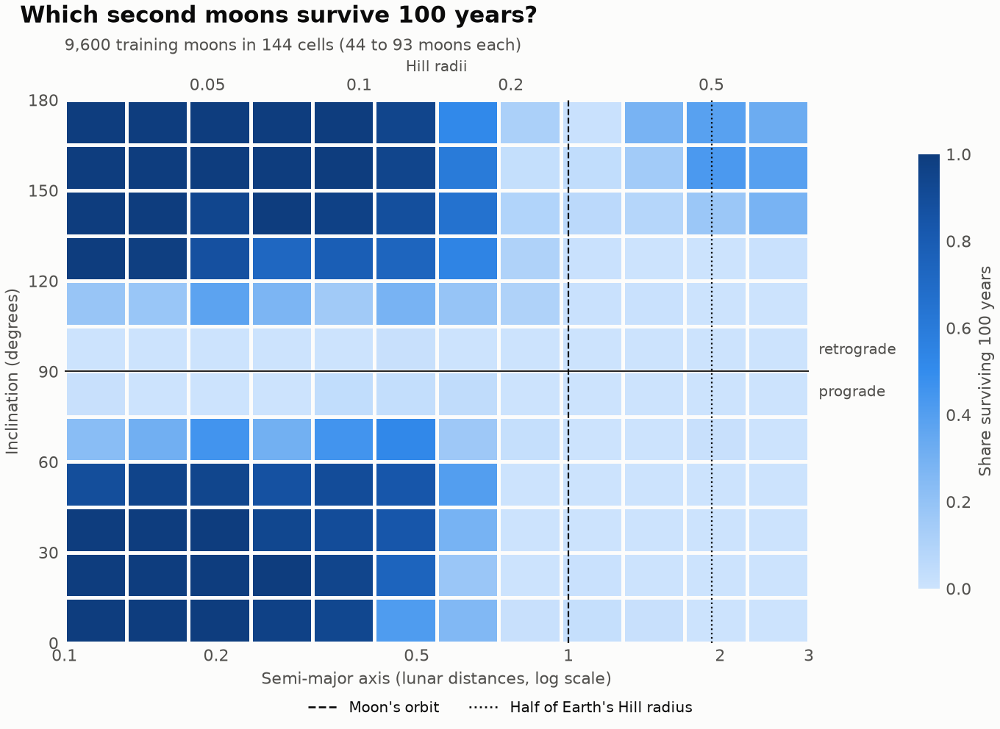
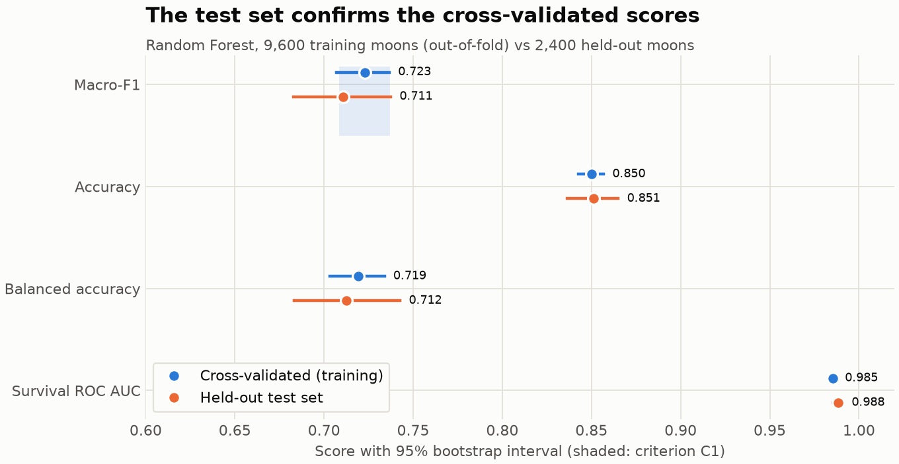

# What if Earth had two moons? A plain-language summary

Earth has one moon. Billions of years ago it may have had a second, smaller one that later crashed
into the Moon. This project asks what would happen to a second moon today: would it stay, crash,
or be flung away? And can a computer learn to answer that question instantly?

## What was done

1. **A realistic virtual solar system.** Starting from NASA's exact positions of the Sun, Earth and
   Moon on 1 January 2026, a gravity simulation moves all three bodies forward in time. Over a
   year, the simulated Moon stays within about 10 km of where NASA says it really is.
2. **12,000 imaginary second moons.** Each run adds one second moon with a random size (from a
   tiny rock to as heavy as our Moon), distance, shape of orbit and tilt, and follows it for up to
   100 years. Each run ends when the second moon survives the full century, crashes into Earth or
   the Moon, or escapes into space.
3. **A machine-learning shortcut.** A model (a Random Forest, a collection of decision trees) was
   trained on most of these results to predict a moon's fate from its starting orbit alone, then
   tested once on 2,400 moons it had never seen.

## What was found

*Dark cells: most second moons survive. Left: close to Earth; right: farther away. Bottom and top
rows: orbits nearly in the plane of Earth's orbit; middle rows: orbits tilted on their side.*

- **About 4 in 10 second moons survive a century.** About 3 in 10 escape and about 3 in 10 crash
  into Earth.
- **Close, flat orbits are safe.** Inside half the Moon's distance, almost all second moons on
  orbits near the plane of Earth's orbit survive (96.5%).
- **Tilted orbits are deadly.** A second moon orbiting at right angles is slowly pushed by the Moon
  and the Sun into an ever more stretched orbit until it hits Earth (99.1% do). Astronomers call
  this the Lidov–Kozai effect.
- **The Moon is the bully.** Orbits that come near the Moon's are almost always destroyed. Far
  beyond the Moon, only moons orbiting "backwards" (against the direction of the Moon) sometimes
  survive.
- **Chaos sets a limit.** Moving a second moon by just 1 meter at the start changes its fate in
  about 8% of cases, so no method can predict every outcome.

- **The shortcut works.** The model predicts the right outcome for 85% of moons it had never seen,
  better than a simple rule of thumb (79%). When it is confident, it is almost always right: its
  most confident half of predictions is 98% correct. Its mistakes are concentrated where chaos
  rules, near the Moon's orbit.
- **The shortcut is fast.** One prediction is 24 times faster than one simulation; predicting many
  moons at once is about 80,000 times faster.

## Why it matters

Simulations like these are accurate but slow. A trained model can scan thousands of possibilities
in seconds and leave the expensive simulations for the uncertain cases. The same idea is used by
astronomers to study the stability of planetary systems around other stars.

## How it was kept honest

The questions and the pass marks were written down before the results were looked at, the 2,400
test moons were locked away until the very end and used exactly once, and every number can be
traced to code that anyone can rerun.

## Limits

The simulation uses gravity only (no tides and no other planets), "survived" means survived 100
years, and the shares depend on how the random moons were drawn.

More detail: the [paper](../paper/main.pdf), the [technical report](report.md) and the
[glossary](glossary.md).
